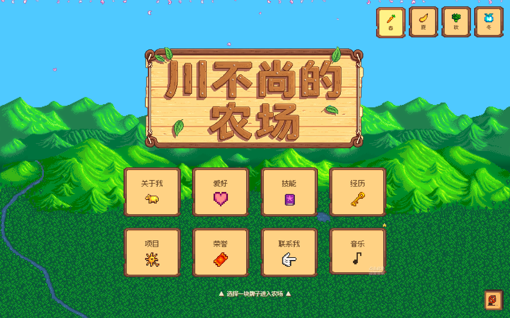
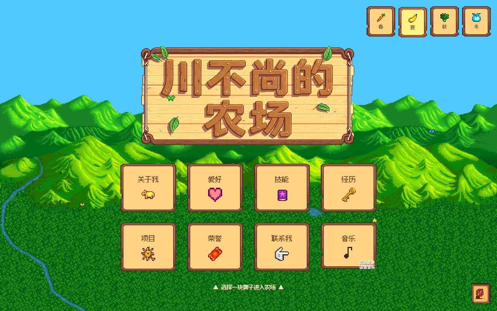
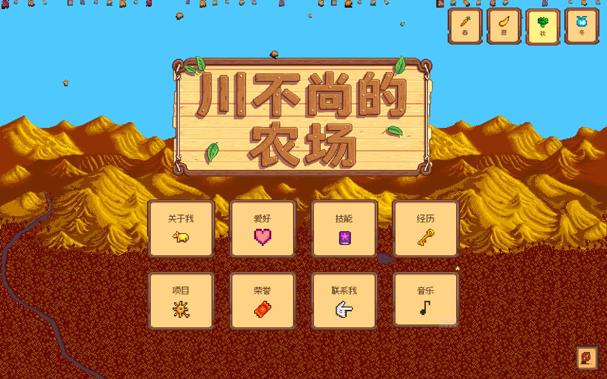
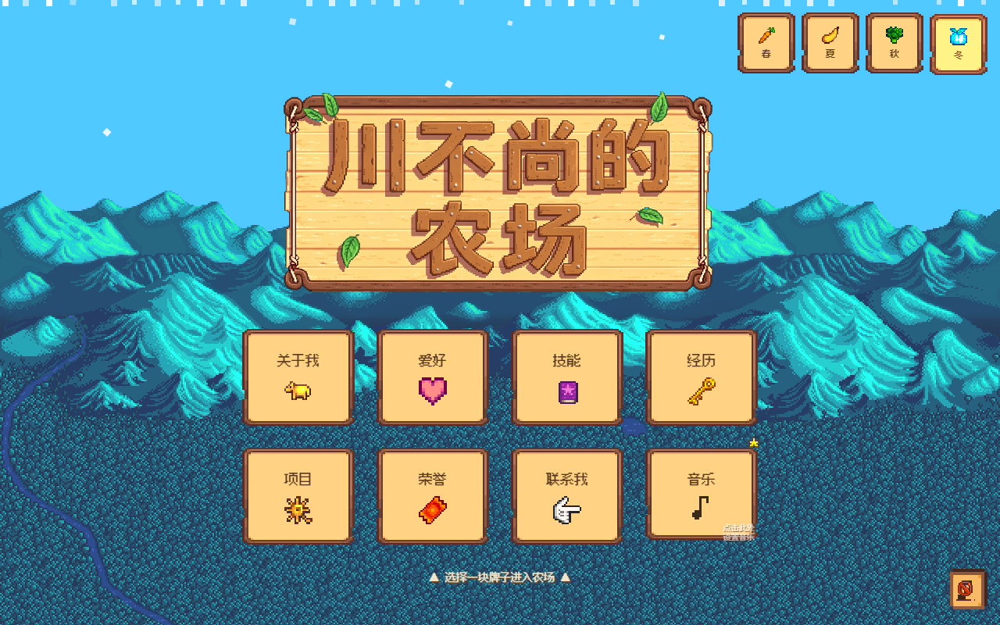
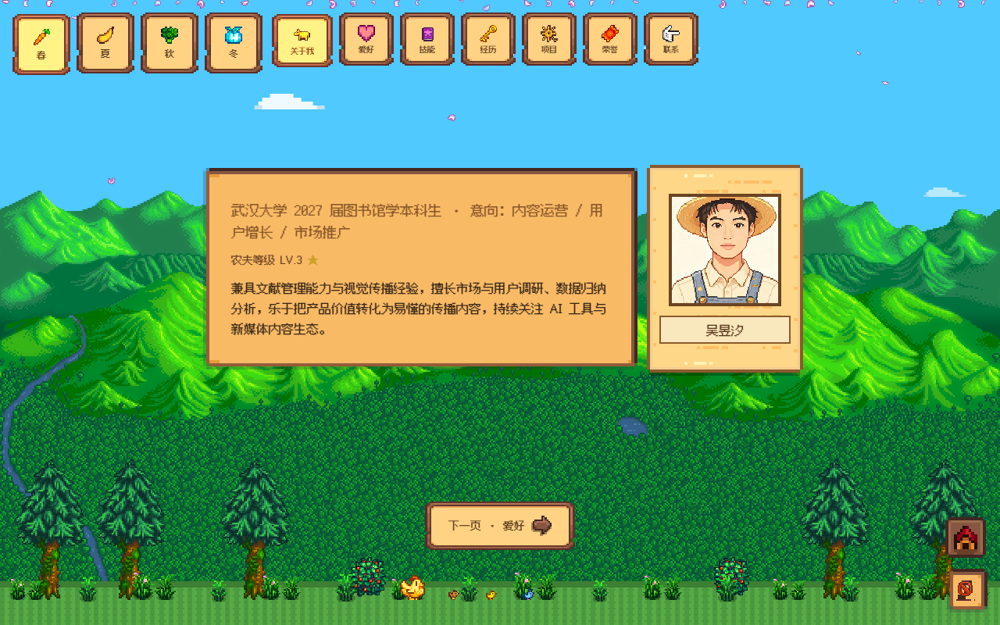

# 川不尚的农场 🌾 Pixel Farm Portfolio

一座开在浏览器里的星露谷农场 —— 把个人简历/作品集「游戏化」的像素风个人网站。

**🌐 线上地址：[chuanbushang.com](https://chuanbushang.com)**

| 春 | 夏 |
|:-:|:-:|
|  |  |
| **秋** | **冬** |
|  |  |

## ✨ 特色

- **星露谷式视觉语言**：全站像素美术 —— 木牌导航、像素字体（缝合像素体）、对话框式自我介绍、农夫等级 LV.3，页脚草地上还有小鸡在跑
- **四季主题系统**：春落花瓣（≤10px 粒子）、夏有蝴蝶循环飞舞、秋染金黄落叶、冬雪覆群山；每季专属 BGM，首次访问按现实月份自动换季
- **NPC 逐帧动画**：爱好页卡片右下角住着星露谷 NPC —— Abigail / Gus / Krobus / Haley 按帧序列循环演出（Haley 的 1→7→8→7→1 恰好是一次完整的举机拍照动作），冬季自动换冬装
- **农场相册**：多图卡片 2.5s/张自动轮播，点开详情可手动切换，再点图片弹出全屏灯箱看原图
- **移动端完整适配**：320–1280px 六种视口宽度逐一截图回归测试；竖屏折叠菜单、粒子降级保流畅
- **静音起播 BGM**：页面加载先静音开播（浏览器允许），首次点击瞬间取消静音——把自动播放限制变成引导彩蛋
- **全站像素 UI**：按钮、图标、提示文字（渐显渐隐的「点击此处/设置音乐」）统一 8-bit 风格



## 🛠 技术栈

- **框架**：React 18 + TypeScript + Vite
- **样式**：Tailwind CSS + 手写 CSS keyframes 逐帧动画（无游戏引擎）
- **路由**：React Router（关于我 / 爱好 / 技能 / 经历 / 项目 / 荣誉 / 联系 共 7 页）
- **部署**：Cloudflare Pages + 自定义域名，全球 CDN

## 🚀 本地运行

```bash
npm install
npm run dev    # 开发预览
npm run build  # 构建到 dist/
```

## 📁 目录结构

```
src/
├── data/profile.ts      # 全部内容数据（技能/项目/经历/爱好/荣誉）
├── sections/            # 页面组件（主页标题屏、各内页）
├── components/          # 季节切换、木牌按钮、灯箱、NPC 动画等
└── farm/                # 四季主题上下文（季节、BGM、粒子）
public/assets/           # 像素贴图 / 照片 / 简历 / 各季 BGM
materials-src/           # 原始素材备份
docs/showcase/           # 展示截图
```

## 🌱 幕后

这个网站由我与 AI 结对开发完成：全部需求以自然语言提出（60+ 条），每次改动自动构建 + 截图复核，git 记录了从第一天到现在的全部迭代。制作过程详见学校游戏文化中心展示材料《川不尚的农场·诞生记》。

## 📄 素材说明

像素图标与角色贴图取材自《星露谷物语》（ConcernedApe），仅用于个人非商业作品集展示；摄影与项目图片为本人作品。
